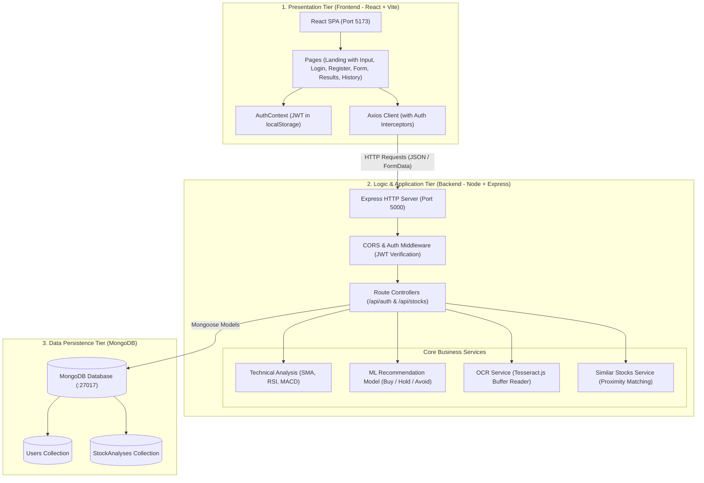
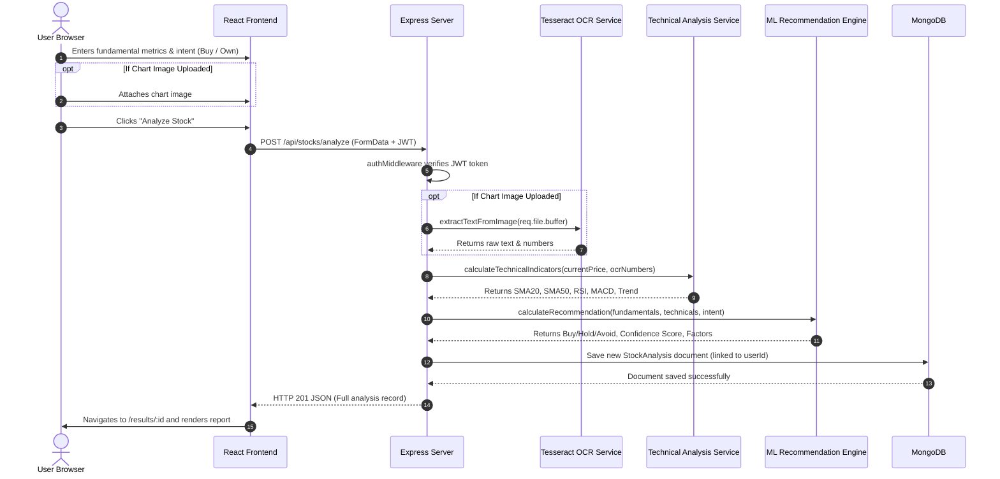

# Stock Analysis & Recommendation System — SWE Project Guide

A complete Software Engineering guide covering the project's architecture, folder and page responsibilities, data flow, and college viva questions.

---

## 1. Project Overview & System Architecture

The application is built on a **3-Tier Client-Server Architecture** using the **MERN** stack (MongoDB, Express.js, React.js, Node.js). It adheres to the **Separation of Concerns (SoC)** principle by isolating UI presentation, route handling, business logic, and database operations.

> [!NOTE]
> The backend operates **statelessly**. Sessions are validated on each incoming request using cryptographic JSON Web Tokens (JWT) rather than server-side session memory.

---

## 2. What Each Folder & File Does

### Backend Directory (`/backend`)

| File / Folder | Role in the System |
|---|---|
| `server.js` | Main entry point. Initializes Express, applies CORS, mounts API routes, connects to MongoDB via Mongoose, and starts the server on port 5000. |
| `.env` | Stores sensitive environment variables (`PORT`, `MONGO_URI`, `JWT_SECRET`) separate from source code. |
| `models/User.js` | Defines the Mongoose schema for user accounts (Name, Unique Email, Hashed Password, Timestamps). |
| `models/StockAnalysis.js` | Defines the schema for saved stock evaluations (User ID reference, Stock Name, Sector, Ownership Status, Fundamental Metrics, Technical Indicators, OCR Output, Recommendation, Confidence Score, and Peer Stocks). |
| `middleware/auth.js` | Route protection guard. Inspects incoming `Authorization: Bearer <token>` headers, decodes the user ID, and halts unauthorized calls with HTTP `401`. |
| `routes/auth.js` | Authentication controller. Handles user registration, bcrypt password hashing (10 salt rounds), login authentication, and user profile retrieval (`/api/auth/me`). |
| `routes/stocks.js` | Core stock analysis controller. Handles multipart chart uploads with in-memory Multer, invokes technical indicators & ML model, and performs CRUD operations on user history. |
| `services/technicalAnalysis.js` | Calculates historical price momentum indicators: 20-day & 50-day Simple Moving Averages (SMA), 14-period Relative Strength Index (RSI), MACD, and overall trend. |
| `services/recommendationEngine.js` | Machine Learning classification logic combining fundamental valuation parameters and technical indicators to classify stocks as **BUY**, **HOLD**, or **AVOID** with a confidence score. |
| `services/ocrService.js` | Pure JavaScript image processing using `tesseract.js`. Reads text, labels, and price points from chart image buffers with graceful fallback. |
| `services/similarStocks.js` | Evaluates peer companies from a verified benchmark dataset using sector matching and metric Euclidean distance. |

---

### Frontend Directory (`/frontend`)

| File / Folder | Role in the System |
|---|---|
| `index.html` | HTML template mounting the React root (`

`). |
| `src/main.jsx` | React DOM initialization and rendering entry point. |
| `src/App.jsx` | Client-side routing engine using React Router v6. Wraps pages with `<Navbar />`, `<Footer />`, and `<ProtectedRoute>` guards. |
| `src/AuthContext.jsx` | Global state provider for user authentication, token storage, login/logout actions, and session recovery. |
| `src/axios.js` | Centralized Axios instance configured with base URL `http://localhost:5000/api` and automated Bearer token attachment. |
| `src/index.css` | Comprehensive stylesheet providing consistent typography, forms, badges, and responsive tables without heavy external CSS frameworks. |
| `src/pages/` | Contains the individual page view components of the application. |

---

## 3. What Each Page Does

1. **Landing Page (`/` - `LandingPage.jsx`)**
   - The public homepage introducing the software.
   - **Embedded User Input Section:** As specified in the SRS, options for entering desired stock parameters (Market Cap, P/E, P/B, ROE, Debt/Equity, EPS, Book Value, Face Value, Industry P/E) are present directly on the homepage.
   - Allows users to select their intent: **Planning to Buy** vs **Currently Own**.
   - Directly executes stock analysis or prompts unauthenticated visitors to sign in.

2. **Login & Register Pages (`/login`, `/register`)**
   - Handles account creation and login with client-side form validation.
   - Communicates with `/api/auth` endpoints.
   - Saves the returned JWT token to `localStorage` and redirects authenticated users.

3. **Stock Input Page (`/analyze` - `StockInputPage.jsx`)**
   - Dedicated protected page for comprehensive stock analysis.
   - Collects investment intent, core fundamental ratios, balance sheet parameters, and optional chart image.
   - Features drag-and-drop chart upload with live preview and removal.

4. **Results Page (`/results/:id` - `ResultsPage.jsx`)**
   - Visualizes the complete analysis output:
     - **Recommendation Badge:** Color-coded `BUY` (Green), `HOLD` (Yellow), `AVOID` (Red), or `INSUFFICIENT DATA` (Gray).
     - **Confidence Score:** Percentage confidence of the model prediction.
     - **Technical Indicators Card:** Visualizes SMA 20, SMA 50, RSI (14), MACD, and trend momentum.
     - **Financial Parameters Grid:** P/E, Industry P/E, P/B, ROE, Debt/Equity, EPS, Face Value, Book Value, Market Cap.
     - **Contributing Factors Breakdown:** Explains strengths and risk factors driving the decision.
     - **OCR Chart Review:** Displays the uploaded graph and extracted text/numbers.
     - **Similar Sector Peers:** 3 comparable companies with their valuation metrics.

5. **History Page (`/history` - `HistoryPage.jsx`)**
   - Tabular record of all previous analyses run by the current user.
   - Displays stock name, sector, intent, multiples, confidence, recommendation badge, and timestamp.
   - Allows users to re-open any past analysis via **View** or delete unwanted records via **Delete**.

---

## 4. End-to-End Analysis Workflow

---

## 5. College Viva / Exam Questions & Answers

### Q1: What architecture does this project use?
**Answer:** It uses a **3-Tier Client-Server Architecture**:
- **Presentation Tier:** React single-page application built with Vite.
- **Application / Logic Tier:** Node.js with Express.js handling REST APIs, authentication, technical indicator calculations, and the ML classification model.
- **Data Tier:** MongoDB storing structured documents via Mongoose ODM.

---

### Q2: How does the recommendation model combine fundamentals and technical indicators?
**Answer:**
The system combines:
1. **Fundamental Features:** Valuation ratios (P/E relative to Industry P/E, P/B), profitability (ROE, EPS), and leverage (Debt-to-Equity).
2. **Technical Features:** 20-day & 50-day Simple Moving Averages, RSI momentum (identifying overbought > 70 or oversold < 30 conditions), and MACD.
3. **User Intent:** Tailors the advice based on whether the user is *Planning to Buy* (looking for an entry) or *Currently Owns* (evaluating whether to hold or trim).
The classification model weighs these features into an overall confidence score and outputs **BUY**, **HOLD**, or **AVOID**.

---

### Q3: How does JWT authentication work in this application?
**Answer:**
1. During login, the backend verifies the user's password using `bcrypt.compare()`.
2. On success, the backend generates a signed JWT containing `{ userId }` signed with a private `JWT_SECRET`.
3. The frontend stores this token in `localStorage`.
4. An **Axios request interceptor** automatically attaches `Authorization: Bearer <token>` to every subsequent request.
5. `authMiddleware` on the backend validates the signature and extracts `req.user.userId`.

---

### Q4: How is the chart image handled during upload?
**Answer:**
Instead of saving image files to the server's hard drive (which creates temporary file clutter), the application uses `multer.memoryStorage()`. The file is stored temporarily in RAM as a `Buffer` and passed directly to `tesseract.js`, after which memory is garbage collected.

---

### Q5: How does the scoring engine prevent distortion from missing data?
**Answer:**
Each financial ratio has an assigned base weight. If an optional ratio (e.g. Face Value or ROE) is omitted by the user, its weight is deducted from `totalActiveWeight`. The score is computed as:
$$\text{Final Score} = \text{round}\left(\frac{\sum (\text{Metric Score} \times \text{Weight})}{\text{Total Active Weight}}\right)$$
This ensures missing inputs are never penalized as zero. If required core metrics (P/E, P/B) are missing, the system halts and outputs **INSUFFICIENT DATA**.

---

### Q6: What HTTP methods and status codes are used?
**Answer:**
- `POST` (`201 Created` / `400 Bad Request`): For user registration, login, and running a stock analysis.
- `GET` (`200 OK` / `404 Not Found`): For fetching history, single analysis records, and user session info.
- `DELETE` (`200 OK` / `404 Not Found`): For removing an analysis record.
- `401 Unauthorized`: Returned by `authMiddleware` if the JWT is missing or expired.
- `500 Internal Server Error`: For unhandled database or server exceptions.
